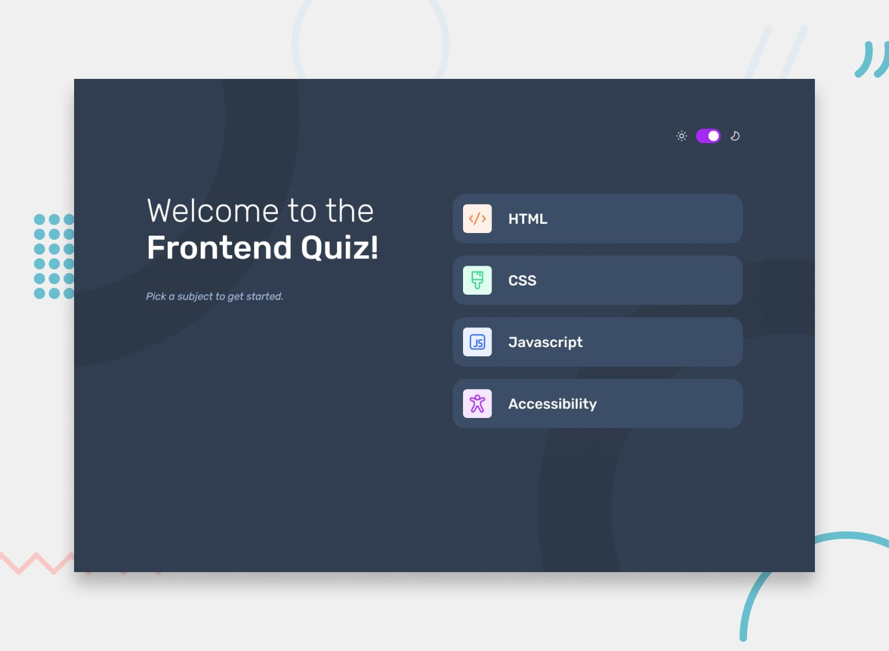
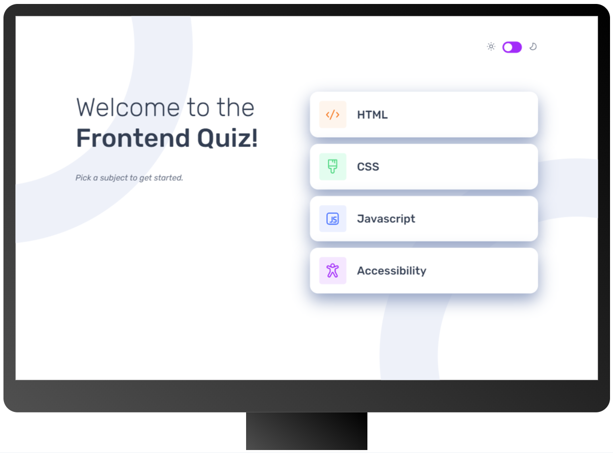

# Frontend Mentor - Frontend quiz app solution

## Welcome! 👋

This is a solution to the [Frontend quiz app challenge on Frontend Mentor](https://www.frontendmentor.io/challenges/frontend-quiz-app-BE7xkzXQnU). Frontend Mentor challenges help you improve your coding skills by building realistic projects.

## Table of contents

- [Overview](#overview)
  - [The challenge](#the-challenge)
  - [Screenshots](#screenshots)
  - [Links](#links)
  - [My process](#my-process)
  - [What I learned](#what-i-learned)
  - [Useful resources](#useful-resources)
  - [Author](#author)
  - [Acknowledgments](#acknowledgments)

## Overview

### The challenge

Users should be able to:

- Select a quiz subject
- Select a single answer from each question from a choice of four
- See an error message when trying to submit an answer without making a selection
- See if they have made a correct or incorrect choice when they submit an answer
- Move on to the next question after seeing the question result
- See a completed state with the score after the final question
- Play again to choose another subject
- View the optimal layout for the interface depending on their device's screen size
- See hover and focus states for all interactive elements on the page
- Navigate the entire app only using their keyboard
- **Bonus**: Change the app's theme between light and dark

### Screenshots

.png?raw=true)

### Links

- Frontend Mentor solution url:    
- Live Site URL: https://atif-dev.github.io/FEM_frontend-quiz-app/

### My process

  - Developed for 1440px, 768px and 375 widths.
  - Developed in terms of code readability.
  - Added keyboard accessibility.
  - Coded JS as defensive programming.
  - Explored Internet for dark and light mode code. Got the code, modified it and used in project.
  - Watched a Youtube video of progress bar(JQuery), used the same concept in plain JS.
  - My efforts + Google + chatGPT.

### What I learned

  - Light and dark mode.
  - Progress bar growth.
  - Tranferring data from one JS page to another (Google search help).
  - Celebration animation by using confetti (Origin: Thapa Technical Youtube video).

### Useful resources

- [Confetti animation by Thapa Technical](https://youtu.be/CimECfuKtmg?si=ZzdJqSbJDJ5pQrit)

## Author

- [atif-dev @ Frontendmentor](https://www.frontendmentor.io/profile/atif-dev)

## Acknowledgments

Completed this project using my existing knowledge plus with the help of Google and chatGPT. Process of building also includes explore code, understand it and modify as per need.
 
**✨Built in a right way and learn in a right way✨** 
